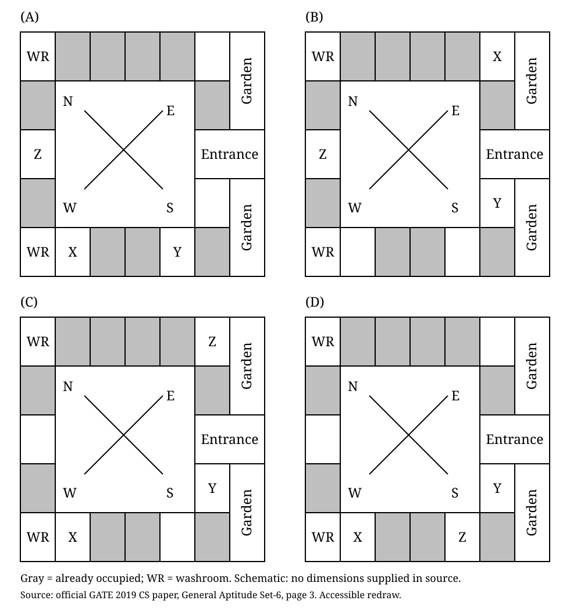

# GATE 2019 CS, normalized Q10 (printed General Aptitude Set-6 Q10)

Source: [Official archived question paper, page 3](https://gate2026.iitg.ac.in/doc/download/2019/cs_2019.pdf#page=3). Source question and original diagrams belong to their respective rights holders; the text specification and schematic redraw below were prepared directly from that question, not from a third-party worked solution.

## Question transcription

Three of the five students allocated to a hostel put in special requests to the warden. Given the floor plan of the vacant rooms, select the allocation plan that will accommodate all their requests.

Request by X: Due to pollen allergy, I want to avoid a wing next to the garden.

Request by Y: I want to live as far from the washrooms as possible, since I am very sensitive to smell.

Request by Z: I believe in Vaastu and so want to stay in the South-west wing.

The shaded rooms are already occupied. WR is washroom.

## All four graphical answer choices

The four choices share the same floor-plan boundaries and shaded rooms. Only the X, Y and Z labels differ. Two of the five vacant rooms are left unlabelled in each choice: the other two students have no stated special requests.

### Compass and common geometry

Directions in this paragraph are page directions, not geographic directions, unless explicitly stated. The building is a rectangle surrounding an unlabelled central rectangular space. Its right-hand exterior has an upper garden, a middle entrance, and a lower garden. The upper and lower gardens each extend alongside two rows of rooms. The entrance occupies the full width of the right-side room strip plus the garden strip. No doorway openings or circulation routes are marked.

The crossed compass lines in the central space have N at upper-left, E at upper-right, S at lower-right and W at lower-left. Thus the geographic north-east wing is along the top of the page, south-east along the right, south-west along the bottom, and north-west along the left.

For a complete description of every boundary and room, use seven conceptual columns numbered 1 through 7 from left to right and five conceptual rows numbered 1 through 5 from top to bottom. These are editorial reference labels, not labels or dimensions in the original. The central space spans columns 2 through 5 and rows 2 through 4, without internal divisions. The following list gives every remaining region:

- Row 1: column 1 is WR; columns 2, 3, 4 and 5 are four separate shaded rooms; column 6 is vacant room V1; column 7 is the upper part of the upper garden.
- Row 2: column 1 is a shaded room; columns 2 through 5 are central space; column 6 is a shaded room; column 7 continues the same upper garden, with no boundary between its two row portions.
- Row 3: column 1 is vacant room V2; columns 2 through 5 are central space; columns 6 and 7 together form the entrance, with no internal vertical division.
- Row 4: column 1 is a shaded room; columns 2 through 5 are central space; column 6 is vacant room V5; column 7 is the upper part of the lower garden.
- Row 5: column 1 is WR; column 2 is vacant room V3; columns 3 and 4 are two separate shaded rooms; column 5 is vacant room V4; column 6 is a shaded room; column 7 continues the same lower garden, with no boundary between its two row portions.

There are therefore ten shaded residential rooms, five vacant residential rooms, two washrooms, two gardens, one entrance, and one unlabelled central space. The V1-V5 names are supplied only to make the options accessible; they do not appear in the original figure or the redraw.

### Placement of every answer label

- **A:** V1 is unlabelled; V2 contains Z; V3 contains X; V4 contains Y; V5 is unlabelled.
- **B:** V1 contains X; V2 contains Z; V3 is unlabelled; V4 is unlabelled; V5 contains Y.
- **C:** V1 contains Z; V2 is unlabelled; V3 contains X; V4 is unlabelled; V5 contains Y.
- **D:** V1 is unlabelled; V2 is unlabelled; V3 contains X; V4 contains Z; V5 contains Y.

### Dimensions and limits of the source

The original gives no numerical lengths, areas, scale, or distance metric. It is a schematic floor plan. The redraw preserves all room boundaries, shared edges, shading, facility labels, compass directions and candidate allocations. Its coordinates are drawing coordinates only, not inferred physical dimensions. Slight scan/panel differences in row heights and page placement have been regularized. Do not use either image to calculate an exact physical distance, and do not interpret the central blank space as a labelled courtyard or corridor: neither label is in the source.

## Detailed original solution

1. Resolve the compass before interpreting the wings. South points diagonally down-right and west diagonally down-left, so south-west points down the page. Z must be in the bottom wing.
2. Check Z first because it distinguishes the choices immediately. In A and B, Z occupies V2 in the left wing, which is north-west rather than south-west. In C, Z occupies V1 near the top-right, not in the bottom wing. In D, Z occupies V4 in the bottom wing. Only D passes Z's request.
3. Confirm X in D. X occupies V3, the bottom room immediately to the right of the lower-left WR. It is away from the gardens on the right, satisfying the garden-avoidance request. X did not request separation from a washroom, so adjacency to WR is not a conflict. B's X, by contrast, occupies V1 directly beside the upper garden.
4. Confirm Y in D. Y occupies V5, on the right immediately below the entrance and directly beside the lower garden. The two washrooms are in the left corners. This is the intended available location away from the washrooms. In particular, the other right-side vacancy V1 lies across the top from the upper WR, while V5 is displaced away from both left-corner washrooms; the left and bottom vacancies do not provide the same separation from the nearby WR. The question gives no numerical distance model, so this is a qualitative schematic comparison, not a claim about a computed number of metres or shortest walking route.
5. The remaining two vacant rooms in D can accommodate the two students without special requests. No shaded room has been allocated to X, Y or Z.

**Answer: D.** The existing repository records D as the official answer; its [key reference is page 17](https://gate2026.iitg.ac.in/doc/download/2019/cs_2019.pdf#page=17). This contribution independently checks the question and figure, not the answer-key page.

## Verification scope

The official PDF's physical page 3 was rendered with Poppler at a 2000-pixel maximum dimension and visually inspected. After generating the SVG, it was independently rendered with Inkscape and visually compared with that original page: each panel's fifteen room positions, ten occupied cells, both WRs, both gardens, entrance, compass labels and all twelve X/Y/Z placements match. The source paragraph and all request sentences were manually transcribed from the original render. This is a complete accessible topology and content reconstruction, not a pixel-identical facsimile or a certified architectural metric reconstruction. This reconstruction has also received an independent comparison against the rendered official page and rendered SVG. It preserves the question text, choice allocations, room boundaries and shading, with the stated non-metric limitation.
