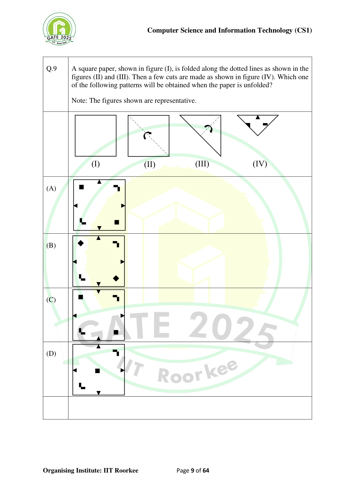

# GATE 2025 CS1 question 9: folding and cuts

[Official source PDF, page 9](https://gate2026.iitg.ac.in/doc/download/2025/CS12025.pdf#page=9). The full rendered page below preserves all folds, cuts, and options without inventing dimensions or redrawing the artwork. The source says its figures are representative.

The question asks which pattern results after unfolding a twice-folded square with three cut shapes. Undo each fold by reflecting the cuts. Option A preserves the four outward-facing triangular edge cuts, the two axis-aligned square holes, and the paired right-angle shapes. B rotates the square holes, C reverses only the top and bottom triangle directions, and D replaces the two off-centre square holes with one central square. See the subject solution for the full derivation.

This source-page image provides faithful visual access, not a vector reconstruction or a certification of screen-reader accessibility for every small shape. The original source and published scoring answer A remain unchanged.
